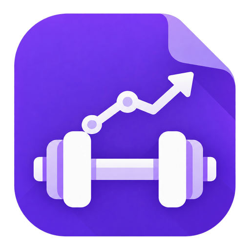

# Workout Planner

[English](README.md) · العربية · [Čeština](README.CZ.md) · [Dansk](README.DA.md) · [Deutsch](README.DE.md) · [Español](README.ES.md) · [Français](README.FR.md) · [हिन्दी](README.HI.md) · [Bahasa Indonesia](README.ID.md) · [Italiano](README.IT.md) · [日本語](README.JA.md) · [한국어](README.KO.md) · [Nederlands](README.NL.md) · [Norsk bokmål](README.NO.md) · [Polski](README.PL.md) · [Português (Brasil)](README.PT-BR.md) · [Português (Portugal)](README.PT.md) · [Română](README.RO.md) · [Русский](README.RU.md) · [Shqip](README.SQ.md) · [Türkçe](README.TR.md) · [Українська](README.UK.md) · [简体中文](README.ZH.md) · [繁體中文](README.ZH-TW.md)

**متتبّع التدريب الشامل لـ Obsidian.** رفع الأثقال والجري وركوب الدراجات واليوغا أو التمارين بحقولك الخاصة: سجّل من هاتفك، واتبع جلسة موجّهة، وتابع تقدمك في المخططات ولوحة التحكم والخريطة الحرارية للعضلات. ملف CSV واحد، و24 لغة.

مصمَّم لهاتفك: سجّل كل مجموعة أو جولة جري أو وضعية أثناء تمرينك، ثم تابع تقدمك في الجداول والمخططات ولوحة التحكم داخل الملاحظات نفسها التي تخطط فيها تدريبك. تُحفظ مجموعاتك في ملف CSV واحد داخل خزنتك. بلا حساب، وبلا سحابة.

تُظهر المخططات اتجاهك، وتُظهر الخريطة الحرارية للعضلات ما دربته، ويحتفظ كل سجل بوحدته الخاصة kg/lb. ويمكنك الاستعلام عن مجموعاتك من Dataview.

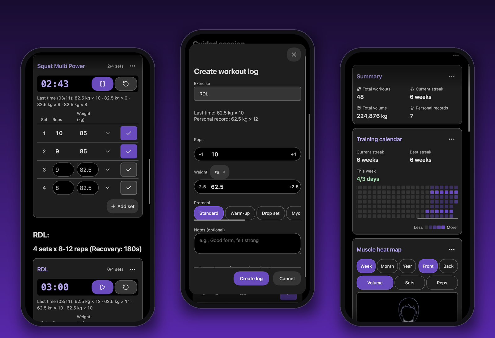

## الميزات

- سجّل المجموعات بالتكرارات والوزن، تُملأ تلقائيًا من آخر مجموعة، مع أزرار +/− وتمارين حديثة بلمسة واحدة
- سجّل كل مجموعة بالكيلوجرام أو الرطل، أيًّا كانت الأثقال أمامك
- علّم المجموعات ببروتوكول: الدروب سِت، والمايو ريبس، والريست بوز، والسوبرسيت، و21s، أو بروتوكولك الخاص
- جداول لمجموعاتك مُجمّعة حسب اليوم مع الإجماليات اليومية، وقابلة للتحرير بلمسة واحدة
- مجموعات اليوم كصفوف تملؤها على هاتفك: أشّر المجموعة لتسجيلها، فيبدأ مؤقت الراحة
- مخططات للوزن والحجم والتكرارات والمدة والمسافة والوتيرة ومعدل ضربات القلب، واتجاه يخبرك بوضوح إن كنت تتحسن
- لوحة تحكم تضم سلسلة أسبوعية (مع هدف أسبوعي)، وتقويم تدريب، والأرقام القياسية الشخصية، والحجم الإجمالي، والتدريبات الأخيرة، وإحصائيات البروتوكولات
- خريطة حرارية للعضلات، أمامًا وخلفًا، حسب الحجم أو المجموعات أو التكرارات
- مؤقتات راحة (عد تنازلي، فترات، ساعة إيقاف) مع إعدادات مسبقة، تعاد تشغيلها عند تسجيل مجموعة، وتصدر صوت تنبيه على iOS وAndroid
- جلسة موجّهة تمر على ملاحظة التدريب تمرينًا تلو الآخر
- تقدير للمدة التي يستغرقها التدريب المخطط
- تمارين القوة ووزن الجسم والمدة الزمنية والمسافة والكارديو، أو حقولك الخاصة
- كل المجموعات في ملف CSV بسيط واحد يمكن قراءته من Dataview وTemplater
- مصمَّم للهواتف: بلا تمرير جانبي، والأزرار دائمًا في متناول يدك
- متاح بـ 24 لغة

## البدء

عند أول تثبيت للإضافة، تضيف ملاحظات نموذجية (تمارين عينة، وتدريبين مع ستة أسابيع من السجلات، ولوحة تحكم، وعرضًا للميزات)، وتوجّه الإضافة إليها، وتفتح دليل **البدء**: صفحة قصيرة لكل ميزة، مع أمثلة عملية تجربها. لست بحاجة إلى فتح الإعدادات. تصفّح بحرية قبل أن تضبط إعداداتك.

### الجولة الإرشادية

تفتح الجولة ملاحظة باسم "جولة إرشادية" تحتوي على جدول ومخطط ولوحة تحكم ومؤقت، وتشير إلى كل منها بالتتابع. وتتكون من تسع خطوات قصيرة:

1. سجّل أول مجموعة لك بزر **+**. تنتهي الخطوة عند حفظها.
2. عدّل مجموعة أو احذفها بالأزرار الموجودة في كل صف.
3. تابع تقدمك في المخطط.
4. اطّلع على الإجماليات والاتجاهات في لوحة التحكم.
5. تعرّف على العضلات التي دربتها في الخريطة الحرارية للعضلات.
6. ابدأ مؤقت الراحة. تنتهي الخطوة عند ضغطك على بدء.
7. اعثر على أيقونة الدمبل في الشريط الجانبي، وهي تفتح نموذج التسجيل من أي ملاحظة. على الهاتف، استخدم لوحة الأوامر بدلًا منها.
8. شغّل أي أمر من **إدراج التدريب** من لوحة الأوامر. تنتهي الخطوة عند تنفيذه.
9. تم.

استخدم **رجوع** و**التالي** للتنقل، أو **تخطي** للخروج. إذا كان الجزء الذي تشير إليه الجولة خارج الشاشة، يقوم **اعرض لي** بالتمرير إليه. اضغط `Esc` في أي وقت لإنهائها. تنتهي الجولة أيضًا عند إغلاق ملاحظتها أو الانتقال إلى ملف آخر. لا يضيع شيء: تبقى مجموعاتك في السجل.

عند استخدام بيانات النموذج، تعمل الجولة عليها. وإلا فإنها تعمل على سجلك الخاص، لذا يكون المخطط ولوحة التحكم فارغين تقريبًا. تُنشأ الملاحظة مرة واحدة، بجوار الأمثلة أو في أعلى خزنتك. لا تُستبدل ملاحظة موجودة أبدًا، ويمكنك تعديلها أو حذفها. إذا كانت هناك ملاحظة باسم "جولة إرشادية" وليست من إنشاء الجولة، تستخدم الجولة "جولة إرشادية 1" (أو الرقم الحر التالي) بدلًا منها.

تريد إعادة الجولة؟ حدّد **ابدأ الجولة** ضمن **الإعدادات → Workout Planner → البدء**، أو شغّل **ابدأ الجولة** من لوحة الأوامر.

تريد الأمثلة أو الدليل مرة أخرى؟ حدّد **إنشاء أمثلة** أو **فتح دليل البدء السريع** ضمن **الإعدادات → Workout Planner → البدء**، أو شغّل **إنشاء ملاحظات نموذجية** أو **فتح دليل البدء السريع** من لوحة الأوامر (`Ctrl/Cmd + P`). إنشاء الأمثلة لا يستبدل شيئًا: تشغيله مرة أخرى يضيف ملفات الأمثلة الناقصة فقط، وتبقى الملفات التي غيّرتها كما هي. يعرض الدليل إنشاء الأمثلة إن لم تكن موجودة بعد. وكل جدول أو مخطط أو لوحة تحكم فارغة يحتوي على رابط **أو استكشف ببيانات نموذجية**. وإذا كان لديك سجل تدريب بالفعل، تحصل الأمثلة على ملف سجل خاص بها ويبقى سجلك دون مساس.

لإضافة جدول إلى أي ملاحظة، مثلًا `Push Day`:

````markdown
```workout-log
exercise: Bench Press
```
````

اضغط **+** أسفل الجدول، وأدخل التكرارات والوزن، ثم احفظ. يتحدّث الجدول تلقائيًا. ولا يلزمك كتابة الكتل بيدك أيضًا: فأوامر **إدراج مخطط التدريب** و**إدراج جدول التدريب** و**إدراج مؤقت التدريب** و**إدراج لوحة التحكم** و**إدراج مدة التدريب** تفتح نموذجًا وتُدرج الكتلة نيابةً عنك.

## تسجيل المجموعات

افتح نموذج التسجيل بالضغط على **+** أسفل الجدول (يُملأ التمرين تلقائيًا)، أو بأيقونة الدمبل في الشريط الجانبي، أو بأمر **إنشاء سجل تدريب**. يبدأ النموذج من آخر مجموعة سجلتها، لذا تضغط في معظم الأحيان **+/−** مرة واحدة ثم تحفظ. افعل ذلك قبل أن تنتهي راحتك.

يطلب النموذج الحقول التي تناسب التمرين: التكرارات والوزن للسكوات، والثواني للبلانك، والمسافة والوقت للجري (راجع [أنواع التمارين](#أنواع-التمارين)). ويمكن لكل مجموعة أن تحمل ملاحظة وبروتوكولًا، ويظهر البروتوكول شارة في الجدول.

يحتوي حقل الوزن على منتقٍ للكيلوجرام والرطل، فيمكنك تسجيل 225 lb حتى لو كانت إعداداتك بالكيلوجرام. يعرض الجدول هذه المجموعة بقيمة "225 lb"، أما المخططات والإحصائيات والحجم فتحوّل كل مجموعة إلى وحدة إعداداتك.

عند تسجيل مجموعة من ملاحظة، يُحفظ اسم الملاحظة باعتباره **التدريب** للمجموعة، فيجدها لاحقًا أي جدول أو مخطط يحمل `workout: Push Day`.

## الجداول

تعرض كتلة `workout-log` مجموعات تمرين أو تدريب، والأحدث أولًا. تُجمَّع المجموعات من اليوم نفسه تحت صف يحمل إجماليات ذلك اليوم، ولكل صف زر تعديل؛ احذف المجموعة من نموذج التعديل. وعلى الهاتف تصبح كل مجموعة صفًا مدمجًا دون تمرير جانبي.

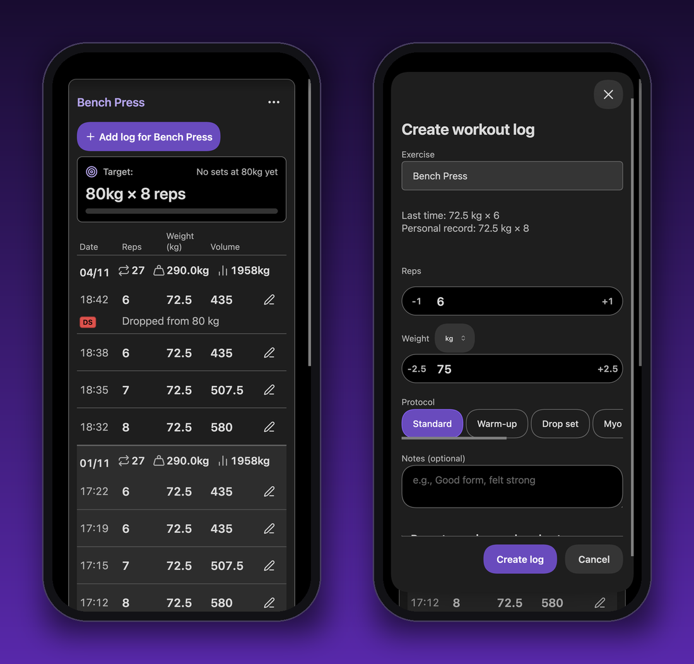

```workout-log
exercise: Bench Press
dateRange: 14
targetWeight: 100
targetReps: 8
```

مع `targetWeight` و`targetReps` يظهر هدف للتحميل التدريجي فوق الجدول.

<details>
<summary>كل المعلمات</summary>

| المعلمة                      | الافتراضي | وظيفتها                                              |
| ---------------------------- | --------- | ---------------------------------------------------- |
| `exercise`                   | —         | هذا التمرين فقط                                      |
| `workout`                    | —         | هذا التدريب فقط (اسم الملاحظة)                       |
| `exactMatch`                 | `false`   | مطابقة اسم التمرين تمامًا                            |
| `dateRange`                  | الكل      | اليوم والأيام السابقة لعدد N                         |
| `limit`                      | `50`      | أقصى عدد صفوف؛ ومع `sets` يصبح `sets × 2` (تدريبان)  |
| `sortBy`                     | `date`    | `date` أو `exercise` أو `weight` أو `reps` أو `volume` |
| `sortOrder`                  | `desc`    | `asc` أو `desc`                                      |
| `columns`                    | الكل      | الأعمدة المعروضة، مثل `["date", "reps", "weight"]`   |
| `showProtocol`               | `true`    | إظهار عمود شارة البروتوكول                           |
| `showAddButton`              | `true`    | إظهار زر **+**                                       |
| `targetWeight`, `targetReps` | —         | إظهار هدف التحميل التدريجي فوق الجدول                |
| `sets`                       | —         | المجموعات المخططة، تحسبها كتلة `workout-session`     |

تتطابق أسماء التمارين بمرونة افتراضيًا ("squat" تجد "Squat (high bar)")؛ أضف `exactMatch: true` لاسم بعينه فقط.

</details>

## مجموعات التمرين على الهاتف

كتلة `workout-sets` مصممة للتسجيل في الصالة: مجموعات اليوم لتمرين واحد كصفوف تملؤها. يعرض كل صف ما فعلته في المجموعة نفسها المرة الماضية، فتكتب ما تغيّر فقط (الحقل الفارغ يسجّل تلك القيمة) ثم تؤشّر الصف. تدخل المجموعة إلى السجل، ويتحول الصف إلى مجموعة مسجّلة، ويبدأ مؤقت الراحة في الأعلى من تلقاء نفسه. يغيّر سهم المجموعة المسجّلة بروتوكولها وملاحظاتها؛ وإلغاء تأشيرها يسحبها من السجل، مع **تراجع** لبضع ثوانٍ.

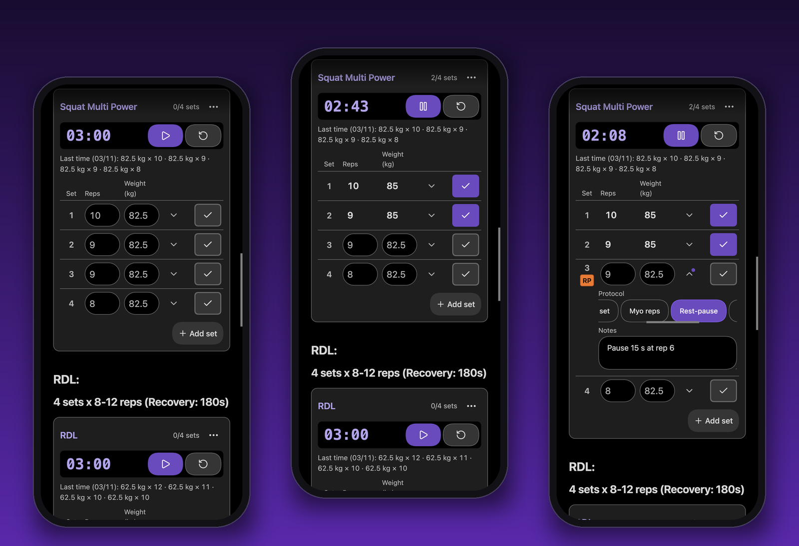

```workout-sets
exercise: Squat
sets: 4
rest: 120
```

**إدراج مجموعات التمرين** من لوحة الأوامر يكتب واحدة لك، وقائمة ⋮ تحرّرها أو تحرّر مؤقت راحتها.

<details>
<summary>كل المعلمات</summary>

| المعلمة                      | الافتراضي      | وظيفتها                                                                                          |
| ---------------------------- | -------------- | ------------------------------------------------------------------------------------------------ |
| `exercise`                   | —              | التمرين (الاسم الدقيق)                                                                           |
| `workout`                    | اسم الملاحظة   | التدريب الذي تُسجَّل تحته المجموعات                                                              |
| `sets`                       | كما في المرة السابقة | الصفوف للتعبئة (واحد على الأقل)؛ **إضافة مجموعة** تضيف المزيد                             |
| `targetWeight`, `targetReps` | —              | تلميحات حين لم يُمارَس التمرين من قبل، وهدف التحميل التدريجي                                     |
| `rest`                       | —              | ثوانٍ الراحة بعد كل مجموعة؛ `0` بلا مؤقت. غير محدد: `workout-timer` في القسم نفسه               |
| `timer.*`                    | —              | خيارات مؤقت الراحة الأخرى: `timer.type` و`timer.preset` و`timer.rest` و`timer.rounds` و`timer.showControls` و`timer.sound` |

</details>

## المخططات والاتجاهات

تُرسم كتلة `workout-chart` قياسًا واحدًا عبر الزمن: الوزن أو الحجم أو التكرارات أو تقدير 1RM أو المدة أو المسافة أو الوتيرة أو معدل ضربات القلب. يُظهر الرأس ما إذا كان الاتجاه **تصاعديًا** أو **ثابتًا** أو **تنازليًا**. ويعني الثبات أن خط الاتجاه يتحرك أقل من 5% من المتوسط عبر الفترة كلها، لذا يظل التحسن البطيء والمستمر تصاعديًا. وبالنسبة للوتيرة، الأقل أفضل، فالخط الهابط يُعرض كتحسن. وعلى الهاتف يصبح المخطط جدولًا بالقيم نفسها.

استخدم `type: e1rm` لأفضل تقدير يومي لتكرار أقصى واحد (Epley: `weight × (1 + reps / 30)`). تُحتسب الأوزان الموجبة فقط مع تكرارات صحيحة من 1 إلى 12، وتُستبعد مجموعات الإحماء والدروب سِت. تُحذف الأيام التي لا تحتوي على مجموعات مؤهلة. تتبع التقديرات إعداد kg/lb لديك. ويبقى مخطط القوة الافتراضي هو الحجم.

```workout-chart
exercise: Bench Press
type: e1rm
dateRange: 180
```

تضيف الواجهة البرمجية `estimatedOneRepMax` إلى `getExerciseStats`: أفضل تقدير بوحدة الوزن المضبوطة، أو `null` عندما لا توجد مجموعة مؤهلة. تبقى حقول الأرقام القياسية الحالية وأعمدة CSV دون تغيير.

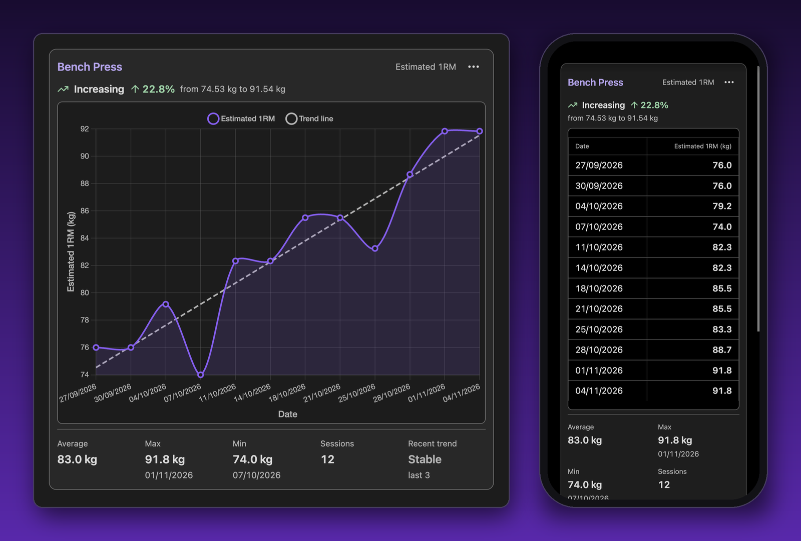

```workout-chart
exercise: Squat
type: volume
dateRange: 90
showTrendLine: true
```

<details>
<summary>كل المعلمات</summary>

| المعلمة         | الافتراضي      | وظيفتها                                                                   |
| --------------- | -------------- | ------------------------------------------------------------------------- |
| `exercise`      | —              | هذا التمرين فقط                                                           |
| `workout`       | —              | هذا التدريب فقط                                                           |
| `type`          | `volume`       | `volume` أو `weight` أو `reps` أو `duration` أو `distance` أو `pace` أو `heartRate` |
| `chartType`     | `exercise`     | كيفية بناء نقطة كل يوم (أدناه)                                            |
| `dateRange`     | `30`           | عدد الأيام المشمولة                                                       |
| `limit`         | —              | آخر N نقطة فقط                                                            |
| `showTrendLine` | `false`        | رسم خط الاتجاه                                                            |
| `showStats`     | `true`         | إظهار المتوسط وأفضل قيمة وأدنى قيمة أسفل المخطط                           |
| `title`         | `Trend <type>` | عنوان المخطط                                                              |
| `height`        | 4:3            | `300` (بكسل) أو أي طول CSS مثل `50vh`                                     |
| `exactMatch`    | `false`        | مطابقة اسم التمرين تمامًا                                                 |

| `chartType` | المجموعات المستخدمة                 | نقطة كل يوم |
| ----------- | ----------------------------------- | ----------- |
| `exercise`  | مجموعات `exercise`                  | المتوسط     |
| `workout`   | مجموعات `workout`                   | الإجمالي    |
| `combined`  | مجموعات `exercise` داخل `workout`   | الإجمالي    |
| `all`       | كل المجموعات (تتجاهل الفلاتر)       | الإجمالي    |

</details>

## لوحة التحكم والخريطة الحرارية للعضلات

تبدأ كتلة `workout-dashboard` بأربعة أرقام: إجمالي التدريبات، والسلسلة الأسبوعية، والحجم الإجمالي، والأرقام القياسية الشخصية. وتحتها إحصائيات سريعة للأسبوع والشهر والسنة، واتجاه الحجم، وتدريباتك الأخيرة، وإحصائيات البروتوكولات، والمدة المخططة مقابل الفعلية، وتقويم تدريب: سنة كاملة من أيام التدريب مظللة حسب الحجم، مع سلسلتك الحالية وأفضل سلسلة. يُحتسب الأسبوع ضمن السلسلة بمجرد بلوغ عدد أيام التدريب هدفك الأسبوعي (الإعدادات → الهدف الأسبوعي، والافتراضي 1). وعلى الهاتف تأتي الإجراءات السريعة أولًا، ويصبح الملخص شبكة 2 × 2.

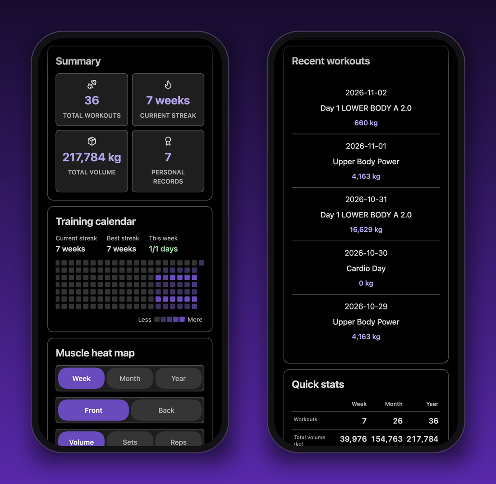

```workout-dashboard
title: Last three months
dateRange: 90
widgets: [summary, heatMap, volume, recentWorkouts]
```

لاختيار الأدوات وترتيبها دون كتابة YAML، أدرج لوحة التحكم بأمر **إدراج لوحة التحكم**، أو افتح قائمة ⋮ في أعلى يمين لوحة مُدرجة واختر **تعديل لوحة التحكم**.

اضبط **التخطيط** على **شبكة** في تلك النافذة لوضع كل أداة بنفسك، كالعناصر في مخزون: اسحب الأداة لتحريكها، واسحب زاويتها لتوسيعها أو تطويلها، وأفلِتها أسفل الشبكة لإزالتها من اللوحة. لوحة المفاتيح تعمل أيضًا: الأسهم للتحريك، وShift مع الأسهم لتغيير الحجم، وDelete لإزالة الأداة. تحتوي الشبكة على عدد من الأعمدة يناسب عرض ملاحظتك؛ وفي اللوحة الأضيق تُعاد تعبئة الأدوات بترتيب القراءة، وعلى الهاتف تُكدَّس. يُحفظ تخطيطك: فعندما تتسع الملاحظة لعمود واحد فقط (كما في الهاتف)، تسألك النافذة كم عمودًا تريد للتعديل، بدءًا من الأعمدة المحفوظة. تحتفظ الكتلة بسطر واحد لكل أداة (العمود والصف والعرض والارتفاع):

```workout-dashboard
layout: grid
columns: 3
grid.summary: 1 1 3 1
grid.heatMap: 1 2 2 2
grid.recentWorkouts: 3 2 1 1
```

تُظهر الخريطة الحرارية العضلات التي دربتها خلال الأسبوع أو الشهر أو السنة، أمامًا وخلفًا، حسب **الحجم** أو **المجموعات** أو **التكرارات**. وهي أسرع طريقة لملاحظة أنك أهملت الساقين لثلاثة أسابيع. وتحتها يحذّرك تحليل تدريبي قصير من الاختلالات، مثل أن تعمل الأمامية أكثر بكثير من الخلفية. وتقرأ الخريطة علامات العضلات من [صفحات تمارينك](#أنواع-التمارين). تفتقر تمارين وزن الجسم والتمارين الموقوتة إلى وزن، لذا تضيء تحت **المجموعات** و**التكرارات** فقط.

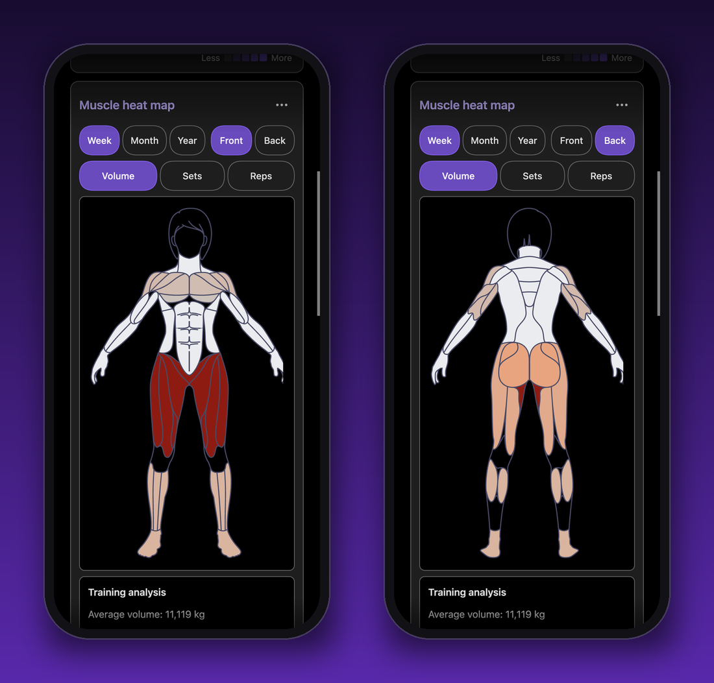

<details>
<summary>كل المعلمات</summary>

| المعلمة               | الافتراضي | وظيفتها                                                                                                                                                                                                     |
| --------------------- | --------- | ----------------------------------------------------------------------------------------------------------------------------------------------------------------------------------------------------------- |
| `title`               | —         | عنوان فوق لوحة التحكم                                                                                                                                                                                       |
| `dateRange`           | الكل      | المجموعات من آخر N يومًا فقط                                                                                                                                                                                |
| `widgets`             | الكل      | الأدوات المعروضة بهذا الترتيب: `summary`, `quickStats`, `heatMap`, `volume`, `recentWorkouts`, `protocolDistribution`, `protocolEffectiveness`, `duration`, `quickActions`, `fileErrors`, `muscleTags`, `trainingCalendar` |
| `layout`              | `list`    | `grid` يضع كل أداة في خلاياها (انظر أعلاه)                                                                                                                                                                  |
| `columns`             | —         | الشبكة: الأعمدة التي صُمّمت لها                                                                                                                                                                             |
| `grid.<widget>`       | —         | الشبكة: العمود والصف والعرض والارتفاع لتلك الأداة                                                                                                                                                           |
| `recentWorkoutsLimit` | `5`       | التدريبات في القائمة الأخيرة                                                                                                                                                                                |
| `volumeTrendDays`     | `30`      | الأيام في مخطط اتجاه الحجم                                                                                                                                                                                  |

</details>

<details>
<summary>علامات العضلات</summary>

يمكن أن تكون العلامات قائمة، أو كلمة واحدة (`tags: chest`)، أو سطرًا مفصولًا بفواصل (`tags: chest, triceps`).

المجموعات العامة: `chest`, `back`, `shoulders`, `biceps`, `triceps`, `forearms`, `traps`, `quads`, `hamstrings`, `glutes`, `calves`, `abs`, `core`

للعضلات المحددة منطقتها الخاصة في الجسم، وتُحتسب ضمن مجموعتها. تنتشر العلامة العامة على المنطقة كلها: فـ `chest` تضيء الأجزاء الثلاثة للصدر قليلًا، أما `upper_chest` فتضيء العلوي وحده بالكامل.

| المجموعة    | العضلات المحددة                             |
| ----------- | ------------------------------------------- |
| `chest`     | `upper_chest`, `mid_chest`, `lower_chest`   |
| `shoulders` | `front_delts`, `side_delts`, `rear_delts`   |
| `back`      | `lats`, `rhomboids`, `lower_back` (أو `ql`) |
| `core`      | `obliques`, `serratus`                      |

تعمل العلامات بلغتك أيضًا، مثل `petto` أو `schiena`. تحوّلها الإضافة إلى المجموعات أعلاه باستخدام `muscle-tags.csv`، بجوار سجلك. عدّل الملف من **إدارة علامات العضلات** (إضافة، وإعادة تسمية، وبحث، وكشف التكرارات)، أو يدويًا:

```csv
tag,muscleGroup,language
petto,chest,it
dorsali,lats,it
```

تعمل العلامة التي هي اسم مجموعة بالفعل (`upper_chest` أو `Upper chest` أو `upper-chest`) دائمًا، حتى لو لم يذكرها `muscle-tags.csv`.

</details>

## المؤقتات

كتلة `workout-timer` مؤقت عد تنازلي أو فترات أو ساعة إيقاف. احفظ أوقات راحتك المعتادة كإعدادات مسبقة. اربط المؤقت بتمرين أو تدريب فيُعاد تشغيله في كل مرة تسجل فيها مجموعة، فلا تحتاج إلى لمسه بين المجموعات. ومع `autoStart: true` يبدأ بمجرد فتح الملاحظة.

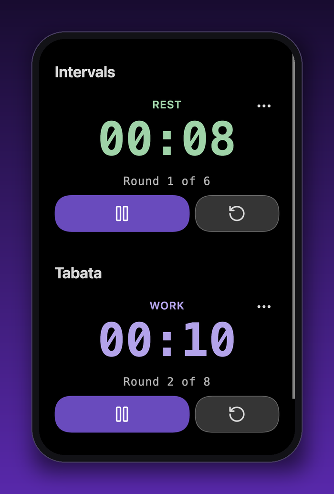

يُصدر صوت تنبيه على iOS وAndroid أيضًا. لا تسمح الهواتف بالصوت إلا بعد أن تلمس الصفحة، لذا يبقى المؤقت الذي يبدأ بـ `autoStart` صامتًا حتى تضغط **ابدأ** مرة واحدة.

ضمن **الإعدادات → Workout Planner → إشارات جهاز المؤقت**، يكون **إبقاء الشاشة مضاءة أثناء تشغيل المؤقت** مفعّلًا افتراضيًا. يطلب حماية الشاشة طالما يعمل مؤقت واحد على الأقل في المقدمة، حيثما يسمح الجهاز. أما **الاهتزاز عند انتهاء المؤقت** فمعطّل افتراضيًا، ويضيف نبضة قصيرة عند الصفر مستقلةً عن الصوت، على الأجهزة المدعومة مثل Android. يحتفظ iOS بإشارة الصوت الحالية، ولا يتوفر الاهتزاز في الويب هناك. تعتمد هذه الميزات على واجهات المتصفح بأفضل جهد ممكن، ولم يُتحقق منها بعد على أجهزة Android وiOS فعلية. ولا توفر منبهات في الخلفية. يستمر المؤقت الذي له `id` في العمل عند تغيير الملاحظات؛ أوقفه أو دعه ينتهي لتحرير حماية الشاشة.

```workout-timer
type: countdown
duration: 90
exercise: Bench Press
```

يمكن للمؤقت بالفترات أن يتناوب بين العمل والراحة. يعرض المؤقت **العمل** أو **الراحة**، ولكل مرحلة صوتها الخاص. كل جولة هي عملها متبوعًا براحتها، بما في ذلك الأخيرة، لذا يستغرق Tabata هذا مدة 4:00 دقائق:

```workout-timer
type: interval
work: 20
rest: 10
rounds: 8
```

`preset: Tabata` (20 ث عمل، 10 ث راحة، 8 جولات) و`preset: EMOM` (جولة كل دقيقة لمدة 10 دقائق) مدمجان. ويحل إعداد محفوظ بالاسم نفسه محلهما.

<details>
<summary>كل المعلمات</summary>

| المعلمة               | الافتراضي   | وظيفتها                                                                  |
| --------------------- | ----------- | ------------------------------------------------------------------------ |
| `type`                | `countdown` | `countdown` أو `interval` أو `stopwatch`                                 |
| `duration`            | `30`        | ثوانٍ (للعد التنازلي؛ وللفترات عمل كل جولة)                              |
| `work`                | —           | الفترات: ثوانٍ العمل لكل جولة (يحل محل `duration`)                       |
| `rest`                | `0`         | الفترات: ثوانٍ الراحة بعد عمل كل جولة                                    |
| `rounds`              | `1`         | الجولات (للفترات)                                                        |
| `sound`               | `true`      | تنبيه صوتي عند انتهاء الوقت                                              |
| `autoStart`           | `false`     | يبدأ بمجرد فتح الملاحظة                                                  |
| `showControls`        | `true`      | إظهار البدء والإيقاف المؤقت وإعادة الضبط                                 |
| `preset`              | —           | البدء من إعداد مسبق (محفوظ، أو `Tabata` أو `EMOM`)؛ والمعلمات تتجاوزه     |
| `exercise`, `workout` | —           | إعادة تشغيل المؤقت عند تسجيل مجموعة لهذا التمرين أو التدريب              |
| `superset`            | `false`     | للتصدير إلى Canvas فقط: رسم هذا التمرين والتالي له كسوبرسيت              |

</details>

## الجلسة الموجهة

كتلة `workout-session` في أعلى ملاحظة التدريب (الأمر **إدراج جلسة موجّهة**) تأخذك خلاله تمرينًا تلو الآخر: المجموعة التي أنت فيها، والهدف، وما فعلته في المرة السابقة، وزر **تسجيل مجموعة**، ومؤقت الراحة الذي يبدأ عند تسجيل مجموعة.

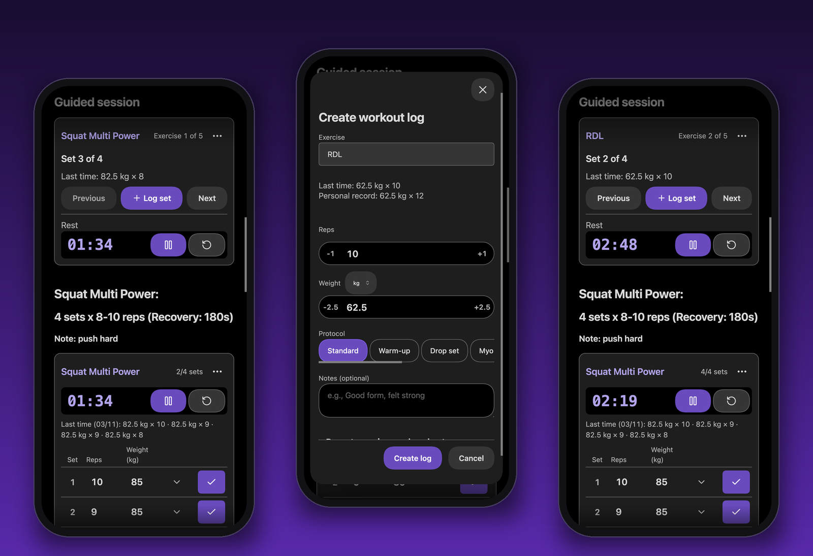

````markdown
```workout-session
```

## Squat

```workout-sets
exercise: Squat
sets: 4
targetReps: 8
targetWeight: 100
rest: 180
```
````

الخطة هي الملاحظة نفسها: كل كتلة `workout-log` أو `workout-sets` فيها `exercise` تصبح خطوة، بحسب ترتيب ظهورها، مع `sets` و`targetReps` و`targetWeight`. أما الراحة فتأتي من `rest` في كتلة `workout-sets` نفسها إن وُجد، وإلا فمن `workout-timer` في القسم `##` نفسه (الإعداد الافتراضي إن لم يوجد). وتتشارك الجلسة وبطاقة مجموعات التمرين عدّادًا واحدًا. تحسب الجلسة المجموعات التي سجلتها اليوم في هذا التدريب، فتبدأ من حيث توقفت عند إعادة فتح الملاحظة. التمرين الذي لا يحمل `sets` يبقى حاليًا حتى تسجل مجموعة لتمرين لاحق؛ ويمكن التنقل بحرية باستخدام **السابق** و**التالي**.

## مدة التدريب

تقدّر كتلة `workout-duration` المدة التي تستغرقها ملاحظة التدريب: الراحة من مؤقتاتها زائد الوقت لكل مجموعة، بجوار المدة التي استغرقتها جلستك الأخيرة فعلًا.

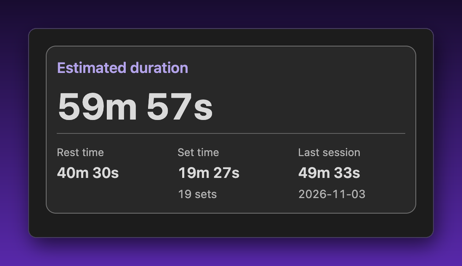

```workout-duration
workout: Workouts/Push Day.md
```

يمكن أن تكون `workout` مسارًا داخل الخزنة، أو مسارًا نسبيًا لهذه الملاحظة، أو اسم الملاحظة فقط؛ واتركها فارغة لتقدير الملاحظة الحالية. تأتي ثوانِي التكرار والمجموعة من [الإعدادات](#الإعدادات).

## أنواع التمارين

صفحة التمرين ملاحظة في مجلد التمارين. يحدد frontmatter الخاص بها ما يطلبه نموذج التسجيل، والعضلات التي يدرّبها التمرين. ويصنع **إنشاء صفحة التمرين** واحدة لك.

```yaml
---
exercise_type: strength
tags:
  - chest
  - triceps
---
```

| `exercise_type`      | يطلب نموذج التسجيل                           | يُقبل أيضًا                                                  |
| -------------------- | -------------------------------------------- | ------------------------------------------------------------ |
| `strength` (الافتراضي) | التكرارات، والوزن                          | `bodyweight`, `weights`                                      |
| `timed`              | المدة                                        | `duration`, `time`, `timer`, `interval`, `hold`, `isometric` |
| `distance`           | المسافة، والمدة (اختياري)                    | `running`, `run`                                             |
| `cardio`             | المدة والمسافة ومعدل ضربات القلب (اختياري)   | —                                                            |
| `custom`             | الحقول التي تذكرها تحت `parameters` فقط      | —                                                            |

اليوغا تعمل بالطريقة نفسها: كل وضعية هي تمرين `timed`، فيسأل النموذج عن مدة الثبات فقط. وتتضمن الملاحظات النموذجية تدفّق يوغا صباحيًا مع جلسة موجّهة.

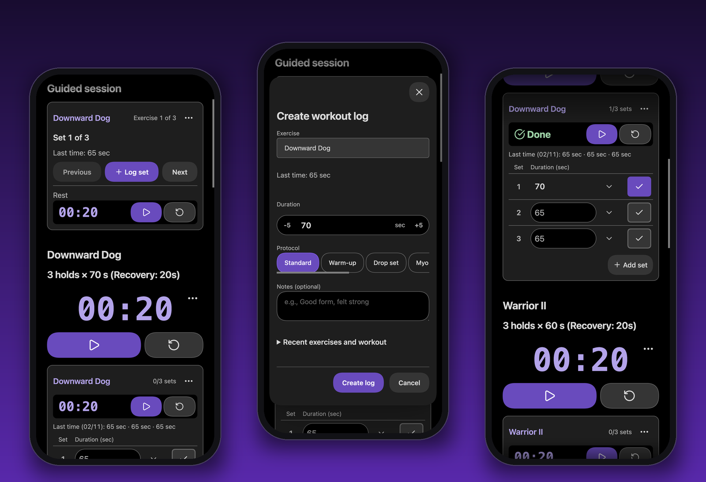

لرياضة تسجّل شيئًا آخر (درجة تسلق، ومحاولات، وهل أنهيت المسار)، أنشئ نوعك الخاص من **الإعدادات → أنواع التمارين**: أعطه اسمًا واختر حقوله، من الحقول المدمجة مثل التكرارات والوزن أو حقول جديدة (رقم أو نص أو نعم/لا). يظهر بعدها في قائمة الأنواع عند إنشاء تمرين، فيكتب `exercise_type: <your type>` في الصفحة. لا يمكن تغيير الأنواع المدمجة، لكن **تكرار** يبدأ نوعًا من أحدها. وحذف النوع يوقف عرضه فقط: التمارين التي تستخدمه تحتفظ بحقولها ومجموعاتها المسجّلة.

`type:` يعمل كما يعمل `exercise_type:`. يمكنك أيضًا إضافة حقول إلى تمرين واحد تحت `parameters`، مثل الجولات لحبل القفز:

```yaml
---
exercise_type: timed
parameters:
  - key: rounds
    label: Rounds
    type: number
    required: false
---
```

إذا غيّرت نوع تمرين بعد تسجيله، فإن أمر **تحويل التمرين** ينقل المجموعات الموجودة، ويتيح لك اختيار مكان كل حقل قديم.

## بياناتك

كل مجموعة هي صف واحد في `workout_logs.csv`، فيمكنك فتحه في جدول بيانات، أو نسخه احتياطيًا، أو مزامنته كأي ملف آخر.

```csv
date,exercise,reps,weight,volume,origine,workout,timestamp,notes,protocol
2025-01-17T10:30:00.000Z,Bench Press,8,100,800,[[Push Day]],Push Day,1737138600000,,standard
```

<details>
<summary>الأعمدة والتعديل يدويًا</summary>

| العمود                     | المعنى                                   |
| -------------------------- | ---------------------------------------- |
| `date`                     | وقت تسجيل المجموعة (ISO 8601)            |
| `exercise`, `workout`      | اسم التمرين والتدريب                     |
| `reps`, `weight`, `volume` | الحجم هو التكرارات × الوزن               |
| `origine`                  | رابط الملاحظة التي سُجّلت منها           |
| `timestamp`                | المعرّف الفريد للصف (بالمللي ثانية)      |
| `notes`, `protocol`        | نص حر وأسلوب التدريب                     |

تضاف أنواع التمارين التي لها حقولها الخاصة (`duration` و`distance` و`heartRate` أو `parameters` لديك) أعمدةً في النهاية. والعمود الأخير `weightUnit` هو `kg` أو `lb`: وحدة `weight` و`volume` لذلك الصف. والقيمة الفارغة تعني الوحدة في الإعدادات.

إذا عدّلت الملف يدويًا، فاحتفظ بصف العناوين، وضع أي قيمة تحتوي على فاصلة أو علامة اقتباس أو سطر جديد بين علامتي اقتباس مزدوجتين. تُحفَظ الملاحظات التي تبدأ بـ `=` أو `+` أو `-` أو `@` مع `'` في البداية حتى لا تنفذها الجداول كمعادلات؛ وتخفيها الإضافة مرة أخرى.

</details>

كل شيء يبقى داخل خزنتك. تكتب الإضافة إلى الحافظة فقط عندما تنقر على شارة نسخ (علامة عضلات في لوحة التحكم)، ولا تقرأها أبدًا.

### Dataview و Templater

تكشف الإضافة `WorkoutPlannerAPI` (وأيضًا `window.WorkoutPlannerAPI`) بعد تحميلها.

```dataviewjs
const s = await WorkoutPlannerAPI.getExerciseStats("Bench Press");
dv.paragraph(`Best: ${s.prWeight} × ${s.prReps} on ${s.prDate}`);
```

<details>
<summary>مرجع الواجهة البرمجية وأمثلة إضافية</summary>

| الطريقة                      | تُرجع                                                                                                                                                                                                                                               |
| ---------------------------- | ----------------------------------------------------------------------------------------------------------------------------------------------------------------------------------------------------------------------------------------------------- |
| `getWorkoutLogs(filter?)`    | المجموعات، ولكل منها `date`, `exercise`, `reps`, `weight`, `volume`, `workout`, `notes`, `timestamp`, `protocol`. و`weight` و`volume` بوحدة الإعدادات؛ و`enteredWeight` و`enteredUnit` هما ما سُجّل فعلًا                                                |
| `getExerciseStats(exercise)` | `estimatedOneRepMax`, `totalVolume`, `maxWeight`, `prWeight`, `prReps`, `prDate`, `totalSets`, `averageWeight`, `averageReps`, `lastWorkoutDate`, `trend`                                                                                             |
| `getExercises(filter?)`      | أسماء التمارين مرتبةً: أسماء ملفات صفحات تمارينك (بما فيها المجلدات الفرعية)، أو الأسماء في سجلك إن لم تكن لديك صفحات تمارين. يُبقي `{ tag: "chest" }` التمارين التي تحمل هذه العلامة في صفحتها، لذا تكون النتيجة فارغة بدون صفحات التمارين. |

يقبل `getWorkoutLogs` القيم `exercise` (جزئي، لا يهم حجم الأحرف)، و`workout`، و`dateRange: { start, end }`، و`protocol`، و`exactMatch`.

آخر السكوات، في Dataview:

```dataviewjs
const logs = await WorkoutPlannerAPI.getWorkoutLogs({
  exercise: "Squat",
  dateRange: { start: moment().subtract(30, "days").format("YYYY-MM-DD") },
});
dv.table(
  ["Date", "Reps", "Weight"],
  logs.map((l) => [l.date.slice(0, 10), l.reps, l.weight]),
);
```

في قالب [Templater](https://github.com/SilentVoid13/Templater)، لبدء ملاحظة بأحدث أرقامك:

```markdown
## Squat

<%\*
const s = await WorkoutPlannerAPI.getExerciseStats("Squat");
tR += s.totalSets
? `Best ${s.prWeight} × ${s.prReps} (${s.prDate}), last session ${s.lastWorkoutDate}`
: "No squats logged yet";
%>
```

</details>

## الإعدادات

اضبط مجلدات CSV والتمارين، ووحدة الوزن الافتراضية، وخطوة الوزن لأزرار **+/−**، والإعدادات المسبقة للمؤقتات، وبروتوكولاتك الخاصة (الاسم والاختصار واللون)، والثواني لكل تكرار ولكل مجموعة المستخدمة في تقدير المدة. يشغّل **تشغيل الكل** ضمن **متقدم** جميع مهام الصيانة بعد الترقية.

تغيير وحدة الوزن لا يغيّر تسمية المجموعات القديمة: تحتفظ كل مجموعة بالوحدة التي سُجّلت بها.

<details>
<summary>كل الأوامر</summary>

افتح لوحة الأوامر (`Ctrl/Cmd + P`) واكتب الاسم.

| الأمر                                                       | وظيفته                                                             |
| ----------------------------------------------------------- | ------------------------------------------------------------------ |
| إنشاء سجل تدريب                                             | تسجيل مجموعة                                                       |
| ابدأ الجولة                                                 | خوض الجولة الإرشادية                                               |
| إنشاء ملاحظات نموذجية                                       | إضافة تمارين وتدريبات وسجلات ولوحة تحكم نموذجية                    |
| فتح دليل البدء السريع                                       | فتح الدليل ضمن الأمثلة                                             |
| إدراج مخطط التدريب / جدول التدريب / مؤقت التدريب / لوحة التحكم / مدة التدريب | إدراج كتلة عبر نموذج                          |
| إنشاء صفحة التمرين                                          | صفحة تمرين جديدة بنوعها وعلاماتها                                  |
| إنشاء قسم التمارين                                          | إضافة عنوان ومؤقت وجدول لتمرين إلى الملاحظة الحالية                |
| إضافة كتلة تمرين                                            | إدراج كتلة تمرين مع إكمال تلقائي للاسم                             |
| تحويل التمرين                                               | نقل مجموعات تمرين إلى نوع تمرين آخر                                |
| إدارة علامات العضلات                                        | تحرير `muscle-tags.csv`                                            |
| إنشاء مرجع العلامات                                         | إنشاء ملاحظة تسرد كل علامة عضلة                                    |
| تدقيق أسماء التمارين                                        | إيجاد التمرين نفسه المسجل بتهجئات مختلفة                           |
| تصدير التدريب إلى لوحة Canvas                               | ترتيب التدريب الحالي على لوحة Canvas في Obsidian                   |
| إنشاء ملف سجل CSV                                           | إنشاء سجل فارغ                                                     |
| استيراد من "Strong" أو "Hevy"                               | إضافة مجموعات ملف تصدير Strong أو Hevy إلى السجل                   |
| ترحيل أنواع التمارين، إضافة المعرّفات المفقودة إلى كتل الكود | صيانة بعد الترقية من إصدارات أقدم                                  |

</details>

## استكشاف الأخطاء وإصلاحها

- **تعارض مع Workout Block (`workout-block`).** تسجّل الإضافتان كتل الكود `workout-log`، وتستخدمان `workout_logs.csv` اسمًا افتراضيًا لملف السجل. عطّل إحدى الإضافتين قبل استخدام الأخرى.

- **الجدول أو المخطط فارغ.** تحقق من اسم التمرين و`dateRange` (تعرض المخططات آخر 30 يومًا افتراضيًا). ومع `exactMatch: true` يجب أن يتطابق الاسم تمامًا.
- **تمرين مفقود من الخريطة الحرارية للعضلات.** تحتاج صفحته إلى `tags` للعضلات، ويجب أن تكون داخل مجلد التمارين. وتظهر تمارين وزن الجسم والتمارين الموقوتة فقط تحت **المجموعات** أو **التكرارات**.
- **يطلب نموذج التسجيل التكرارات والوزن لتمرين البلانك.** اضبط `exercise_type: timed` في صفحة التمرين.
- **المؤقت لا يصدر صوتًا على هاتفي.** اضغط **ابدأ** مرة واحدة؛ فالهواتف تمنع الصوت حتى تلمس الصفحة.

## التثبيت

### من إضافات المجتمع

1. افتح **الإعدادات → الإضافات المجتمعية**
2. ابحث عن **Workout Planner**
3. اضغط **تثبيت**، ثم **تفعيل**

### يدوي

1. نزّل `main.js` و`manifest.json` و`styles.css` من [أحدث إصدار](https://github.com/SpatariuRares/obsidian-workout-plugin/releases/latest)
2. أنشئ المجلد `your-vault/.obsidian/plugins/workout-planner/`
3. انسخ الملفات التي نزّلتها إلى هذا المجلد
4. فعّل الإضافة ضمن **الإعدادات → الإضافات المجتمعية**

## الدعم

Workout Planner مجانية ومفتوحة المصدر. إن ساعدتك في تدريبك، فيمكنك أن [تشتري لي قهوة](https://buymeacoffee.com/spatariurares). وجدت خطأً أو ينقصك شيء؟ افتح [مشكلة](https://github.com/SpatariuRares/obsidian-workout-plugin/issues).

جميع اللغات عدا الإنجليزية مترجمة آليًا، لذا قد تبدو بعض العبارات غريبة. وإن بدت لك لغتك غريبة، فالتصحيحات مرحّب بها.

## الشكر والإسناد

تستخدم المخططات [Chart.js](https://github.com/chartjs/Chart.js) (رخصة MIT). وتصدر Workout Planner بموجب [رخصة MIT](LICENSE).
