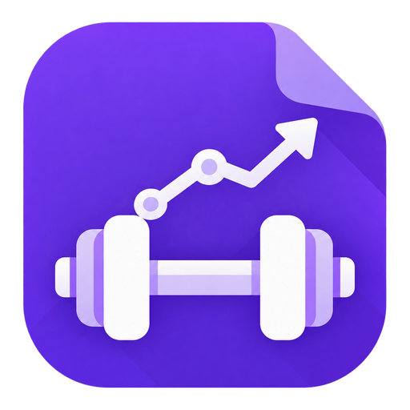
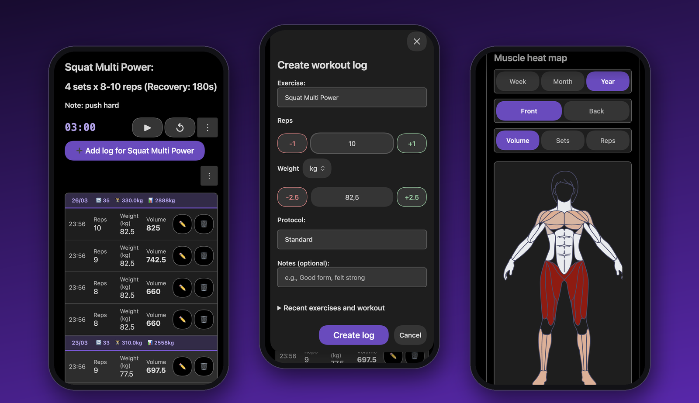
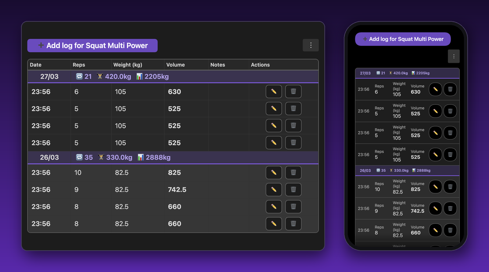
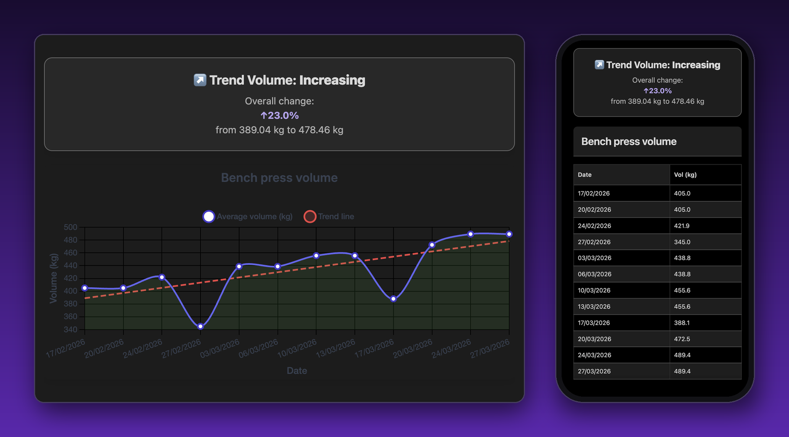
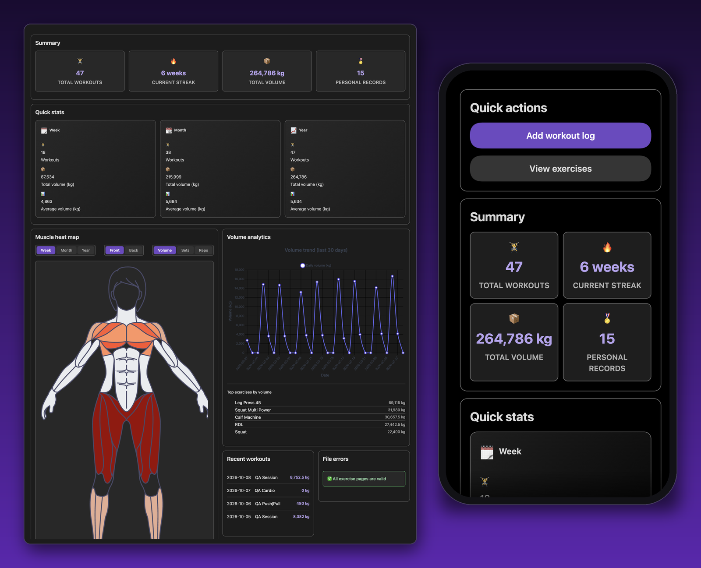
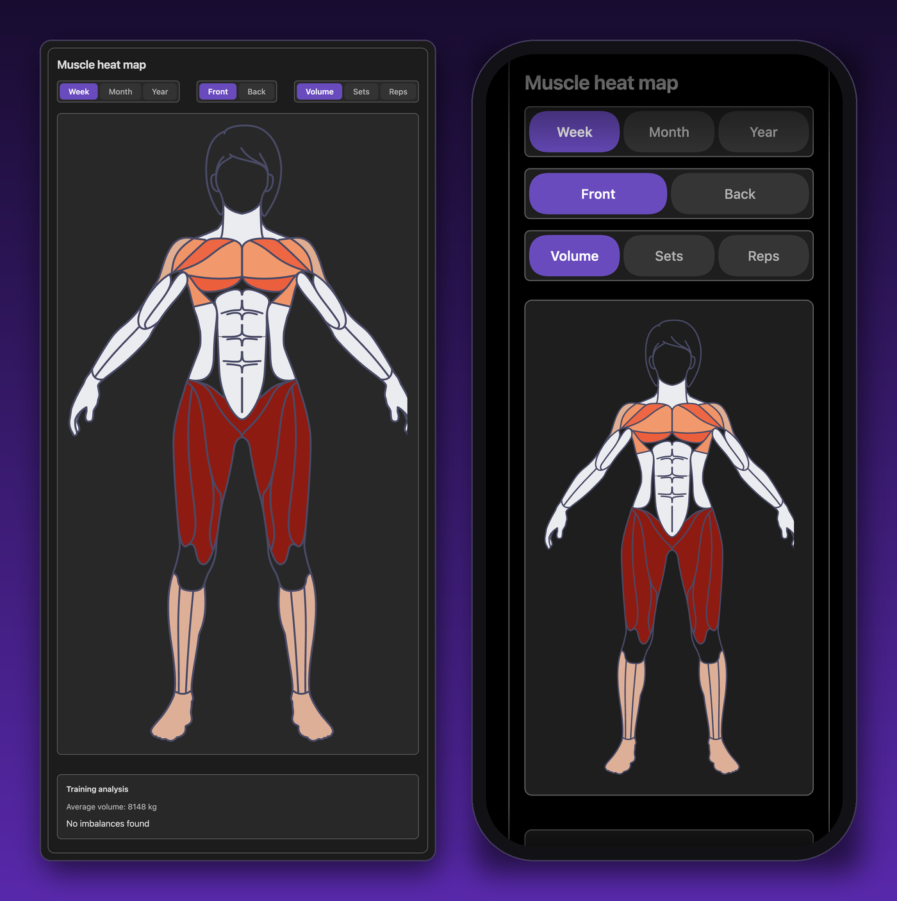
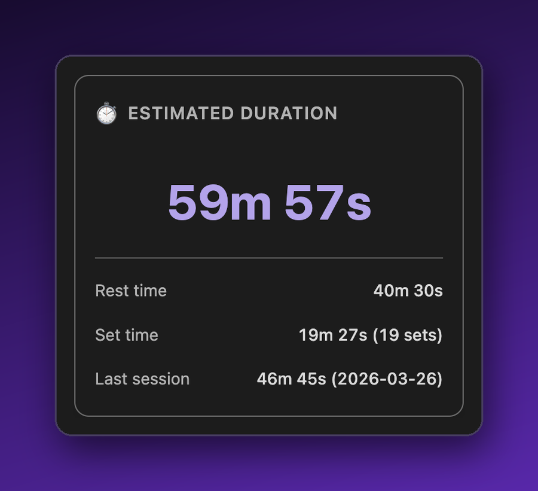

# Workout Planner

Mobile-first workout tracker for Obsidian. Log every set from your phone at the gym, then watch your progress in tables, charts and a dashboard inside the same notes where you plan your training. Your sets go into one CSV file in your vault. No account, no cloud.



## Features

- Log sets with reps and weight, pre-filled from your last set, with +/− buttons and one-tap recent exercises
- Log each set in kg or lb, whatever the plates in front of you say
- Tag sets with a protocol: drop set, myo-reps, rest-pause, superset, 21s, or your own
- Tables of your sets, grouped by day with daily totals, editable with one tap
- Charts for weight, volume, reps, duration, distance, pace and heart rate, and a trend that tells you plainly if you're improving
- A dashboard with weekly streak, personal records, total volume, recent workouts and protocol stats
- A muscle heat map, front and back, by volume, sets or reps
- Rest timers (countdown, interval, stopwatch) with presets, that restart when you log a set and beep on iOS and Android
- An estimate of how long a planned workout takes
- Strength, bodyweight, timed, distance and cardio exercises, or your own fields
- Every set in one plain CSV file, readable from Dataview and Templater
- Built for phones: no sideways scrolling, buttons always in reach
- Available in 24 languages

## Getting started

In **Settings → Workout Planner**, select **Create examples**. You get sample exercises, a few workouts with a month of logs, and a dashboard. Poke around before setting up your own.

When you're ready, set the CSV folder and the exercise folder, select **Create files**, then add a table to any note, for example `Push Day`:

````markdown
```workout-log
exercise: Bench Press
```
````

Tap **+** under the table, enter reps and weight, and save. The table updates on its own. You don't have to write blocks by hand either: the **Insert workout chart / table / timer / dashboard / duration** commands open a form and insert the block for you.

## Logging sets

Open the log form with the **+** under a table (the exercise is filled in for you), the dumbbell icon in the ribbon, or the **Create workout log** command. The form starts from your last set, so most of the time you tap **+/−** once and save. Done before your rest is over.

The form asks for the fields that fit the exercise: reps and weight for a squat, seconds for a plank, distance and time for a run (see [Exercise types](#exercise-types)). Each set can also carry a note and a protocol, shown as a badge in the table.

The weight field has a kg/lb picker, so you can log 225 lb even if your setting is kg. The table shows that set as "225 lb"; charts, stats and volume convert every set to your setting.

When you log a set from a note, the note's name is saved as the set's **workout**, so a table or chart with `workout: Push Day` finds it later.

## Tables

A `workout-log` block shows the sets of an exercise or workout, newest first. Sets from the same day are grouped under a row with that day's totals, and each row has edit and delete buttons. On a phone each set becomes a compact row with no sideways scrolling.



```workout-log
exercise: Bench Press
dateRange: 14
targetWeight: 100
targetReps: 8
```

With `targetWeight` and `targetReps`, a progressive-overload target appears above the table.

<details>
<summary>All parameters</summary>

| Parameter                    | Default | What it does                                       |
| ---------------------------- | ------- | -------------------------------------------------- |
| `exercise`                   | —       | Only this exercise                                 |
| `workout`                    | —       | Only this workout (note name)                      |
| `exactMatch`                 | `false` | Match the exercise name exactly                    |
| `dateRange`                  | all     | Today and the previous N days                      |
| `limit`                      | `50`    | Maximum rows                                       |
| `sortBy`                     | `date`  | `date`, `exercise`, `weight`, `reps` or `volume`   |
| `sortOrder`                  | `desc`  | `asc` or `desc`                                    |
| `columns`                    | all     | Columns to show, e.g. `["date", "reps", "weight"]` |
| `showProtocol`               | `true`  | Show the protocol badge column                     |
| `showAddButton`              | `true`  | Show the **+** button                              |
| `targetWeight`, `targetReps` | —       | Show a progressive-overload target above the table |

Exercise names match loosely by default ("squat" finds "Squat (high bar)"); add `exactMatch: true` for only that exact name.

</details>

## Charts and trends

A `workout-chart` block draws one measure over time: weight, volume, reps, duration, distance, pace or heart rate. The header says whether the trend is **Increasing**, **Stable** or **Decreasing**. Stable means the trend line moves less than 5% of the average over the whole period, so a slow, steady gain still counts as increasing. For pace, lower is better, and a falling line shows as improving. On a phone the chart becomes a table of the same values.



```workout-chart
exercise: Squat
type: volume
dateRange: 90
showTrendLine: true
```

<details>
<summary>All parameters</summary>

| Parameter       | Default        | What it does                                                              |
| --------------- | -------------- | ------------------------------------------------------------------------- |
| `exercise`      | —              | Only this exercise                                                        |
| `workout`       | —              | Only this workout                                                         |
| `type`          | `volume`       | `volume`, `weight`, `reps`, `duration`, `distance`, `pace` or `heartRate` |
| `chartType`     | `exercise`     | How each day's point is built (below)                                     |
| `dateRange`     | `30`           | Days to include                                                           |
| `limit`         | —              | Only the latest N points                                                  |
| `showTrendLine` | `false`        | Draw a trend line                                                         |
| `showStats`     | `true`         | Show average, best and lowest under the chart                             |
| `title`         | `Trend <type>` | Chart title                                                               |
| `height`        | 4:3            | `300` (pixels) or any CSS length such as `50vh`                           |
| `exactMatch`    | `false`        | Match the exercise name exactly                                           |

| `chartType` | Sets used                           | Each day's point |
| ----------- | ----------------------------------- | ---------------- |
| `exercise`  | sets of `exercise`                  | average          |
| `workout`   | sets of `workout`                   | total            |
| `combined`  | sets of `exercise` within `workout` | total            |
| `all`       | every set (filters ignored)         | total            |

</details>

## Dashboard and muscle heat map

A `workout-dashboard` block opens with four numbers: total workouts, weekly streak, total volume and personal records. Below them you get quick stats for the week, month and year, a volume trend, your recent workouts, protocol stats and planned vs. actual workout length. On a phone, quick actions come first and the summary is a 2 × 2 grid.



```workout-dashboard
title: Last three months
dateRange: 90
```

The heat map shows which muscles you trained over the last week, month or year, front and back, by **Volume**, **Sets** or **Reps**. It's the quickest way to notice you've skipped legs for three weeks. Under it, a short training analysis warns you about imbalances, like a front that works much more than the back. It reads the muscle tags of your [exercise pages](#exercise-types). Bodyweight and timed exercises have no weight, so they light up only under Sets and Reps.



<details>
<summary>All parameters</summary>

| Parameter                                                                                        | Default | What it does                   |
| ------------------------------------------------------------------------------------------------ | ------- | ------------------------------ |
| `title`                                                                                          | —       | Heading above the dashboard    |
| `dateRange`                                                                                      | all     | Only sets from the last N days |
| `showSummary`, `showQuickStats`, `showVolumeAnalytics`, `showRecentWorkouts`, `showQuickActions` | `true`  | Hide a section with `false`    |
| `recentWorkoutsLimit`                                                                            | `5`     | Workouts in the recent list    |
| `volumeTrendDays`                                                                                | `30`    | Days in the volume trend chart |

</details>

<details>
<summary>Muscle tags</summary>

Tags can be a list, a single word (`tags: chest`) or a comma-separated line (`tags: chest, triceps`).

Broad groups: `chest`, `back`, `shoulders`, `biceps`, `triceps`, `forearms`, `traps`, `quads`, `hamstrings`, `glutes`, `calves`, `abs`, `core`

Specific muscles have their own area of the body and count toward their group. A broad tag spreads over the whole area: `chest` lights all three parts of the chest a little, `upper_chest` lights only the top one fully.

| Group       | Specific muscles                            |
| ----------- | ------------------------------------------- |
| `chest`     | `upper_chest`, `mid_chest`, `lower_chest`   |
| `shoulders` | `front_delts`, `side_delts`, `rear_delts`   |
| `back`      | `lats`, `rhomboids`, `lower_back` (or `ql`) |
| `core`      | `obliques`, `serratus`                      |

Tags in your own language, like `petto` or `schiena`, work too. The plugin maps them to the groups above using `muscle-tags.csv`, next to your log. Edit it with **Manage muscle tags** (add, rename, search, spot duplicates) or by hand:

```csv
tag,muscleGroup,language
petto,chest,it
dorsali,lats,it
```

A tag that is already a group name (`upper_chest`, `Upper chest`, `upper-chest`) always works, even if `muscle-tags.csv` doesn't list it.

</details>

## Timers

A `workout-timer` block is a countdown, interval or stopwatch timer. Save your usual rest times as presets. Link a timer to an exercise or workout and it restarts every time you log a set, so you don't have to touch it between sets. With `autoStart: true` it starts as soon as the note opens.

It beeps on iOS and Android too. Phones only allow sound after you've tapped the page, so a timer started by `autoStart` stays silent until you tap **Start** once.

```workout-timer
type: countdown
duration: 90
exercise: Bench Press
```

<details>
<summary>All parameters</summary>

| Parameter             | Default     | What it does                                                          |
| --------------------- | ----------- | --------------------------------------------------------------------- |
| `type`                | `countdown` | `countdown`, `interval` or `stopwatch`                                |
| `duration`            | `30`        | Seconds (countdown and interval)                                      |
| `rounds`              | `1`         | Rounds (interval)                                                     |
| `sound`               | `true`      | Beep when time is up                                                  |
| `autoStart`           | `false`     | Start as soon as the note opens                                       |
| `showControls`        | `true`      | Show start, pause and reset                                           |
| `preset`              | —           | Start from a saved preset; other parameters override it               |
| `exercise`, `workout` | —           | Restart the timer when you log a set for this exercise or workout     |
| `superset`            | `false`     | Canvas export only: draw this exercise and the next one as a superset |

</details>

## Workout duration

A `workout-duration` block estimates how long a workout note takes: the rest from its timers plus the time for each set, next to how long your last session really took.



```workout-duration
workout: Workouts/Push Day.md
```

`workout` can be a path in the vault, a path relative to this note, or just the note's name; leave it out to estimate the current note. Seconds per rep and per set come from [Settings](#settings).

## Exercise types

An exercise page is a note in your exercise folder. Its frontmatter says what the log form should ask for and which muscles the exercise trains. **Create exercise page** makes one for you.

```yaml
---
exercise_type: strength
tags:
  - chest
  - triceps
---
```

| `exercise_type`      | The log form asks for                        | Also accepted                                                |
| -------------------- | -------------------------------------------- | ------------------------------------------------------------ |
| `strength` (default) | reps, weight                                 | `bodyweight`, `weights`                                      |
| `timed`              | duration                                     | `duration`, `time`, `timer`, `interval`, `hold`, `isometric` |
| `distance`           | distance, duration (optional)                | `running`, `run`                                             |
| `cardio`             | duration, distance and heart rate (optional) | —                                                            |
| `custom`             | only the fields you list under `parameters`  | —                                                            |

`type:` works the same as `exercise_type:`. Add your own fields under `parameters`, for example rounds for jump rope:

```yaml
---
exercise_type: timed
parameters:
  - key: rounds
    label: Rounds
    type: number
    required: false
---
```

If you change an exercise's type after logging it, **Convert exercise** moves the existing sets over and lets you choose which old field goes where.

## Your data

Every set is one row in `workout_logs.csv`, so you can open it in a spreadsheet, back it up, or sync it like any other file.

```csv
date,exercise,reps,weight,volume,origine,workout,timestamp,notes,protocol
2025-01-17T10:30:00.000Z,Bench Press,8,100,800,[[Push Day]],Push Day,1737138600000,,standard
```

<details>
<summary>Columns and editing by hand</summary>

| Column                     | Meaning                             |
| -------------------------- | ----------------------------------- |
| `date`                     | When the set was logged (ISO 8601)  |
| `exercise`, `workout`      | Exercise and workout name           |
| `reps`, `weight`, `volume` | Volume is reps × weight             |
| `origine`                  | Link to the note it was logged from |
| `timestamp`                | Unique ID of the row (milliseconds) |
| `notes`, `protocol`        | Free text and training technique    |

Exercise types with their own fields (`duration`, `distance`, `heartRate`, or your `parameters`) add columns at the end. The last column, `weightUnit`, is `kg` or `lb`: the unit of that row's `weight` and `volume`. An empty value means the unit in the settings.

If you edit the file by hand, keep the header row, and wrap any value that contains a comma, quote or line break in double quotes. Notes starting with `=`, `+`, `-` or `@` are stored with a leading `'` so spreadsheets don't run them as formulas; the plugin hides it again.

</details>

### Dataview and Templater

The plugin exposes `WorkoutPlannerAPI` (also `window.WorkoutPlannerAPI`) once it has loaded.

```dataviewjs
const s = await WorkoutPlannerAPI.getExerciseStats("Bench Press");
dv.paragraph(`Best: ${s.prWeight} × ${s.prReps} on ${s.prDate}`);
```

<details>
<summary>API reference and more examples</summary>

| Method                       | Returns                                                                                                                                                                                                                                               |
| ---------------------------- | ----------------------------------------------------------------------------------------------------------------------------------------------------------------------------------------------------------------------------------------------------- |
| `getWorkoutLogs(filter?)`    | Sets, each with `date`, `exercise`, `reps`, `weight`, `volume`, `workout`, `notes`, `timestamp`, `protocol`. `weight` and `volume` are in the settings unit; `enteredWeight` and `enteredUnit` are what was logged                                    |
| `getExerciseStats(exercise)` | `totalVolume`, `maxWeight`, `prWeight`, `prReps`, `prDate`, `totalSets`, `averageWeight`, `averageReps`, `lastWorkoutDate`, `trend`                                                                                                                   |
| `getExercises(filter?)`      | Exercise names, sorted: the file names of your exercise pages (subfolders included), or the names in your log when you have no exercise pages. `{ tag: "chest" }` keeps the exercises whose page has that tag, so it is empty without exercise pages. |

`getWorkoutLogs` accepts `exercise` (partial, case-insensitive), `workout`, `dateRange: { start, end }`, `protocol` and `exactMatch`.

Recent squats, in Dataview:

```dataviewjs
const logs = await WorkoutPlannerAPI.getWorkoutLogs({
  exercise: "Squat",
  dateRange: { start: moment().subtract(30, "days").format("YYYY-MM-DD") },
});
dv.table(
  ["Date", "Reps", "Weight"],
  logs.map((l) => [l.date.slice(0, 10), l.reps, l.weight]),
);
```

In a [Templater](https://github.com/SilentVoid13/Templater) template, to start a note with your latest numbers:

```markdown
## Squat

<%\*
const s = await WorkoutPlannerAPI.getExerciseStats("Squat");
tR += s.totalSets
? `Best ${s.prWeight} × ${s.prReps} (${s.prDate}), last session ${s.lastWorkoutDate}`
: "No squats logged yet";
%>
```

</details>

## Settings

Set the CSV and exercise folders, the default weight unit, the weight step of the **+/−** buttons, timer presets, your own protocols (name, short label and color), and the seconds per rep and per set used by the duration estimate. **Run all** under Advanced runs every maintenance task after an upgrade.

Changing the weight unit doesn't relabel old sets: each set keeps the unit it was logged in.

<details>
<summary>All commands</summary>

Open the command palette (`Ctrl/Cmd + P`) and type the name.

| Command                                                     | What it does                                                       |
| ----------------------------------------------------------- | ------------------------------------------------------------------ |
| Create workout log                                          | Log a set                                                          |
| Insert workout chart / table / timer / dashboard / duration | Insert a block through a form                                      |
| Create exercise page                                        | New exercise page with type and tags                               |
| Create exercise section                                     | Add a heading, timer and table for an exercise to the current note |
| Add exercise block                                          | Insert an exercise block, with name autocomplete                   |
| Convert exercise                                            | Move an exercise's sets to another exercise type                   |
| Manage muscle tags                                          | Edit `muscle-tags.csv`                                             |
| Generate tag reference                                      | Create a note listing every muscle tag                             |
| Audit exercise names                                        | Find the same exercise logged under different spellings            |
| Export workout to canvas                                    | Lay out the current workout on an Obsidian canvas                  |
| Create CSV log file                                         | Create an empty log                                                |
| Migrate exercise types, Add missing IDs to code blocks      | Maintenance after upgrading from older versions                    |

</details>

## Troubleshooting

- **A table or chart is empty.** Check the exercise name and the `dateRange` (charts default to the last 30 days). With `exactMatch: true` the name must match exactly.
- **An exercise is missing from the heat map.** Its page needs muscle `tags` and must be in the exercise folder. Bodyweight and timed exercises show up only under **Sets** or **Reps**.
- **The log form asks for reps and weight for a plank.** Set `exercise_type: timed` in the exercise page.
- **The timer makes no sound on my phone.** Tap **Start** once; phones block sound until you touch the page.

## Installation

### From community plugins

1. Open **Settings → Community plugins**
2. Search for **Workout Planner**
3. Select **Install**, then **Enable**

### Manual

1. Download `main.js`, `manifest.json` and `styles.css` from the [latest release](https://github.com/SpatariuRares/obsidian-workout-plugin/releases/latest)
2. Create the folder `your-vault/.obsidian/plugins/workout-planner/`
3. Copy the downloaded files into that folder
4. Enable the plugin in **Settings → Community plugins**

## Support

Workout Planner is free and open source. If it helps your training, you can [buy me a coffee](https://buymeacoffee.com/spatariurares). Found a bug or missing something? Open an [issue](https://github.com/SpatariuRares/obsidian-workout-plugin/issues).

Every language except English is machine-translated, so some phrases may sound off. If yours reads strangely, corrections are welcome.

## Credits

Charts use [Chart.js](https://github.com/chartjs/Chart.js) (MIT). Workout Planner is released under the [MIT License](LICENSE).
